# Análisis de vulnerabilidades en Metasploitable Windows

Estado: resultados de Nmap, conversión a HTML y primera evaluación con Nessus documentados. Correlación de hallazgos entre herramientas, verificación independiente y correcciones pendientes.

## Objetivo y alcance

Evaluar el objetivo propio `192.168.32.132` desde Kali, usando Nmap 7.99. La [enumeración previa](../../02-enumeracion/03-enumeracion-windows/README.md) identificó mediante SMB Windows Server 2008 R2 Standard, compilación 7601, SP1. El entorno está configurado en modo Sólo host.

## Ejecución

```bash
sudo nmap -v -sS -oX vulnerabilidades_tcp.xml --stylesheet="https://svn.nmap.org/nmap/docs/nmap.xsl" --script=vuln 192.168.32.132
```

Se solicitó un escaneo TCP SYN y scripts de la categoría `vuln`, con salida XML. No se añadió `-sV` ni se analizaron puertos UDP. La selección por categoría no equivale a comprobar todas las vulnerabilidades posibles.

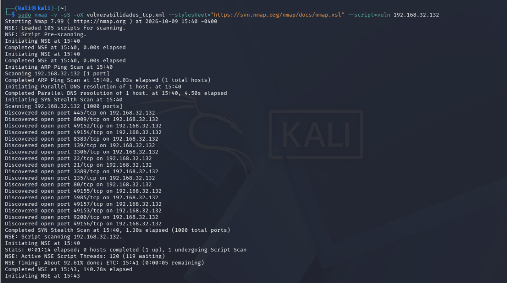

La ejecución cargó 105 scripts, escaneó 1000 puertos TCP y finalizó en 146.79 segundos. Cargar un script no implica que todos sus controles hayan sido aplicables o se hayan completado.

El resumen informa 982 puertos cerrados, es decir, 18 abiertos en esta ejecución. La lista difiere del escaneo general anterior de Windows; no se atribuye esa diferencia a una corrección ni a cambios concretos sin evidencia adicional.

## Hallazgos seleccionados

| Hallazgo | Evidencia de Nmap | Estado de validación |
|---|---|---|
| MS17-010 en SMBv1 | `smb-vuln-ms17-010: VULNERABLE`; identifica CVE-2017-0143 y riesgo HIGH | Detección positiva del script; pendiente de contraste independiente |
| Grupo Diffie-Hellman de fuerza insuficiente, 8383/TCP | `ssl-dh-params: VULNERABLE`; módulo de 1024 bits | Parámetros reportados por el script; corrección y nueva prueba pendientes |

### 1. MS17-010

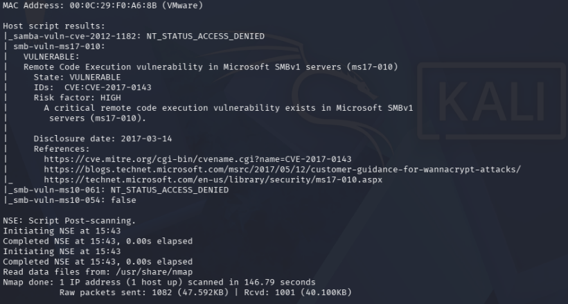

La salida reporta riesgo de ejecución remota de código en SMBv1. Se conserva CVE-2017-0143 tal como aparece en el resultado; no se sustituyen identificadores ni se agregan puntuaciones CVSS que la evidencia no muestra.

El script evalúa respuestas del servidor SMB para detectar el problema. Esta prueba no muestra ejecución de comandos, acceso remoto conseguido ni explotación exitosa. Se propone priorizar su revisión por el impacto indicado, comprobar los parches del sistema y contrastar con Nessus.

Referencia: [documentación de smb-vuln-ms17-010](https://nmap.org/nsedoc/scripts/smb-vuln-ms17-010.html).

### 2. Parámetros Diffie-Hellman débiles

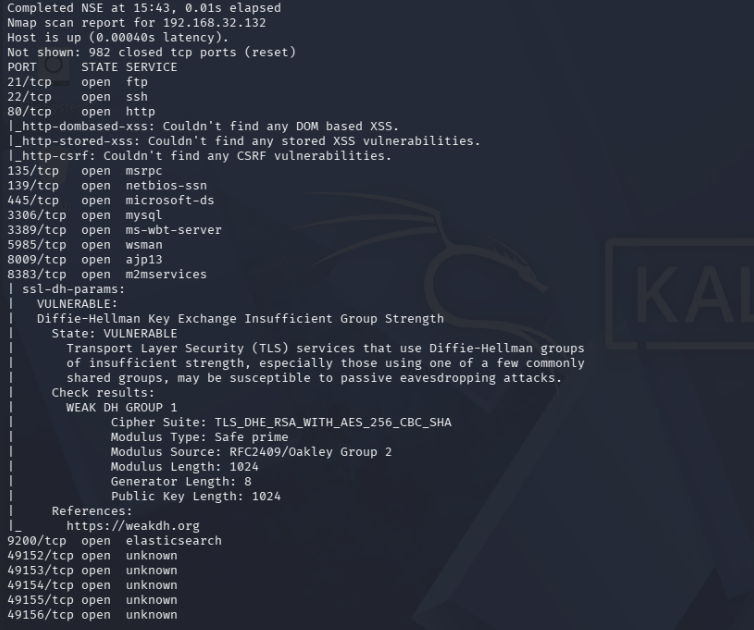

El script informa:

- Suite: `TLS_DHE_RSA_WITH_AES_256_CBC_SHA`.
- Módulo: primo seguro de 1024 bits.
- Fuente del grupo: `RFC2409/Oakley Group 2`.
- Clave pública: 1024 bits.

La debilidad reportada corresponde al intercambio de claves Diffie-Hellman; que la suite incluya AES-256 no elimina el problema del grupo DH. La etiqueta de puerto `m2mservices` no identifica por sí sola el producto que ofrece TLS.

No se asigna automáticamente CVE-2015-4000 (Logjam): la captura muestra fuerza insuficiente del grupo, sin un resultado de exportación DHE_EXPORT ni ese CVE. La comprobación tampoco demuestra descifrado de tráfico.

Se propone identificar el servicio y revisar su configuración TLS y parámetros DH antes de aplicar una corrección. Referencia: [documentación de ssl-dh-params](https://nmap.org/nsedoc/scripts/ssl-dh-params.html).

## Resultados que requieren otra interpretación

- `samba-vuln-cve-2012-1182` y `smb-vuln-ms10-061`: acceso denegado. No equivalen a vulnerabilidades detectadas ni a comprobaciones negativas concluyentes.
- `smb-vuln-ms10-054`: devuelve `false`; no se extrapola a otros fallos SMB.
- Las comprobaciones HTTP de XSS y CSRF en 80/TCP no encontraron resultados. Esto no certifica que la aplicación carezca de esas vulnerabilidades.
- La ausencia de un hallazgo no demuestra que el sistema sea seguro.

## Salida XML y problema de visualización

La captura del directorio muestra `vulnerabilidades_tcp.xml` y Firefox intenta abrirlo desde `/home/kali`, pero falla al cargar la hoja XSL remota.

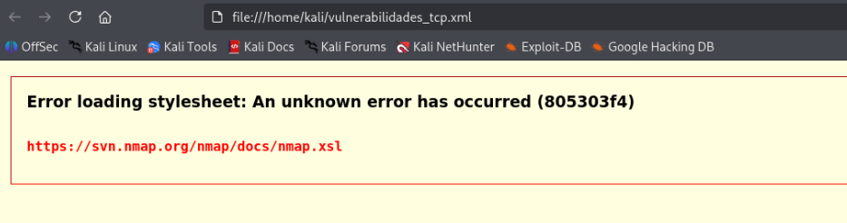

Este error corresponde a la presentación del informe y no invalida por sí solo el escaneo de terminal, que sí finalizó. El XML original todavía no se ha adjuntado al repositorio, por lo que su integridad no se ha verificado.

La documentación de Nmap explica que las restricciones de origen de los navegadores pueden impedir cargar hojas XSL. La captura no permite determinar si intervino esa restricción, la conectividad o una falla al obtener el recurso remoto.

### Solución aplicada: conversión local a HTML

Se convirtió el XML existente utilizando la hoja XSL local de Nmap:

```bash
xsltproc -o vulnerabilidades_tcp.html /usr/share/nmap/nmap.xsl vulnerabilidades_tcp.xml
firefox vulnerabilidades_tcp.html &
```

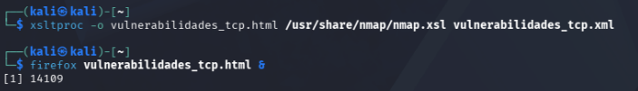

La terminal regresó al prompt tras la conversión y el HTML se abrió correctamente en Firefox. El `&` permite mantener disponible la terminal mientras Firefox está abierto.

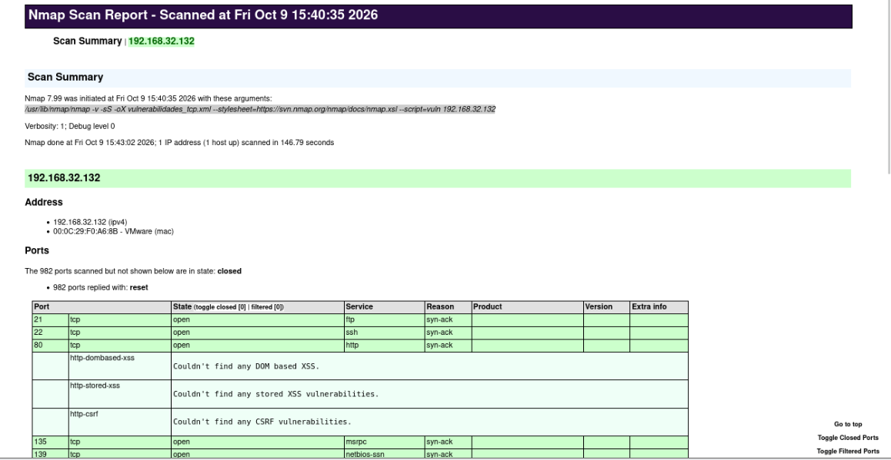

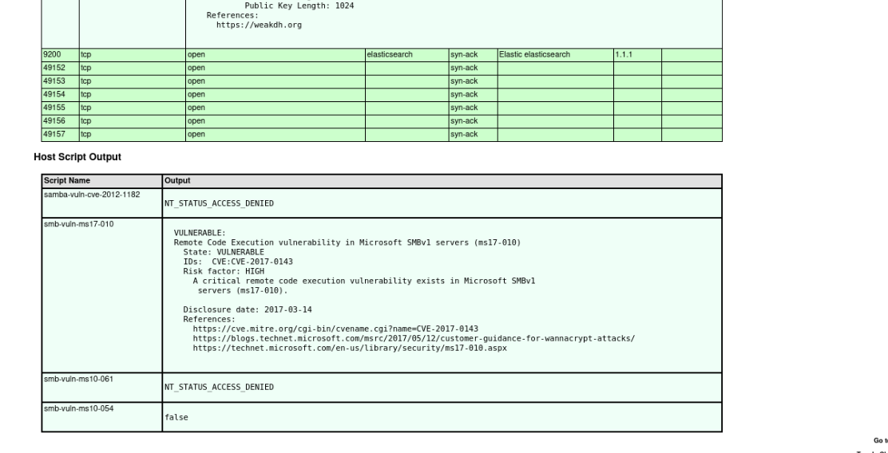

El resumen conserva el objetivo `192.168.32.132`, Nmap 7.99, los 982 puertos cerrados y la duración de 146.79 segundos. La tabla muestra la detección MS17-010 y los resultados SMB de acceso denegado/false ya documentados. Son otra presentación del mismo escaneo, no una nueva comprobación independiente de las vulnerabilidades.

**Incidencia de visualización resuelta**, según las capturas. Se publicó la evidencia visual; los archivos XML y HTML originales todavía no se han adjuntado al repositorio.

No fue necesario repetir el escaneo para generar esta vista. `chmod 777` no es parte de la solución a la carga de la hoja de estilo. No se presenta ningún cambio de permisos o de protecciones de Firefox como verificado mediante estas nuevas capturas.

Referencia: [creación de informes HTML en Nmap](https://nmap.org/book/output-formats-output-to-html.html).

## Evaluación con Nessus

Práctica guiada realizada sobre la misma máquina Windows del laboratorio. Las capturas aportadas documentan la configuración y los resultados; no se dispone todavía de la exportación original `.nessus`. Se seleccionaron evidencias de cada etapa, omitiendo capturas duplicadas y listados parciales sin el nombre del hallazgo.

### Descubrimiento del objetivo

Se configuró `Host Discovery`, nombre `HostDiscoveryTest`, con un único objetivo: `192.168.32.132`. La configuración mostrada utilizó `Host enumeration`.

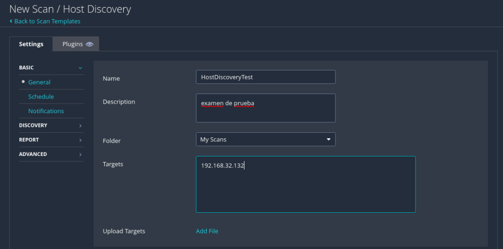

El análisis terminó en aproximadamente un minuto y detectó un host. La vista enumera los puertos 135, 139, 161, 445 y 49152–49157, sin mostrar en esa tabla el protocolo de transporte. No se interpreta esta lista como inventario exhaustivo ni sus dos resultados informativos como dos vulnerabilidades confirmadas.

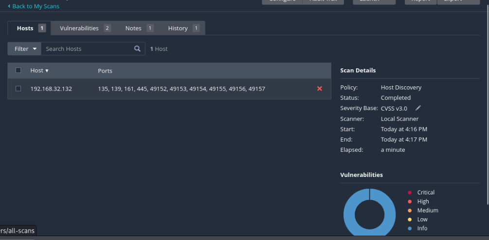

### Análisis de vulnerabilidades

Se ejecutó `Basic Network Scan`, con nombre `Windows-Lab-Vulnerabilidades`, contra `192.168.32.132`. La evidencia no demuestra autenticación exitosa: el resumen muestra `Auth: Fail`.

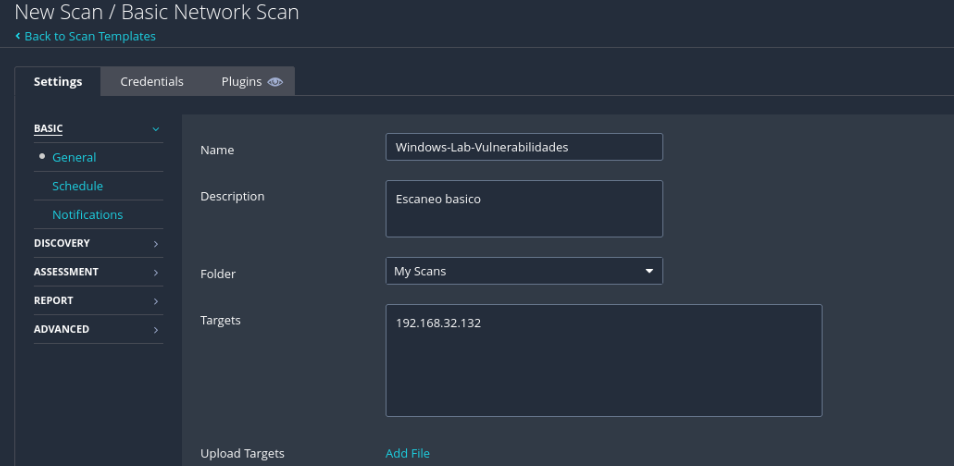

El escaneo figura como `Completed`, de 16:28 a 16:55, con una duración de 27 minutos según la interfaz. Finalizar el trabajo no implica que todas las comprobaciones hayan podido ejecutarse.

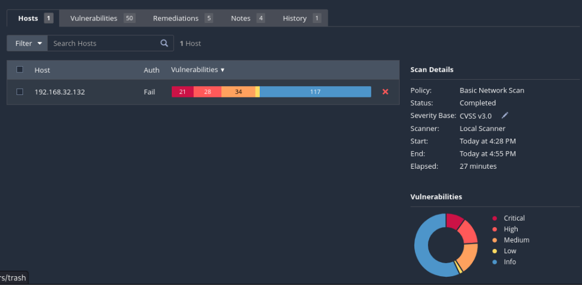

La barra del host muestra **21 resultados críticos, 28 altos, 34 medios y 117 informativos**. Existe un segmento de severidad baja cuyo número no se distingue en la captura; no se estima. La pestaña `Vulnerabilities: 50` presenta una vista agrupada, con filas `MIXED` y una columna `Count`; no se equipara ese contador a 50 CVE únicos ni se suma a los valores de la barra.

### Hallazgo seleccionado: debilidad de intermediario en RDP

| Campo | Dato mostrado por Nessus |
|---|---|
| Nombre | Remote Desktop Protocol Server Man-in-the-Middle Weakness |
| Plugin | 18405, versión 1.34, tipo remoto |
| Severidad | Media |
| CVSS v3.0 base | 6,5 |
| Vector CVSS v3.0 | `CVSS:3.0/AV:N/AC:L/PR:N/UI:N/S:U/C:L/I:L/A:N` |
| CVE | CVE-2005-1794 |
| Evidencia técnica en Output | `No output recorded` |

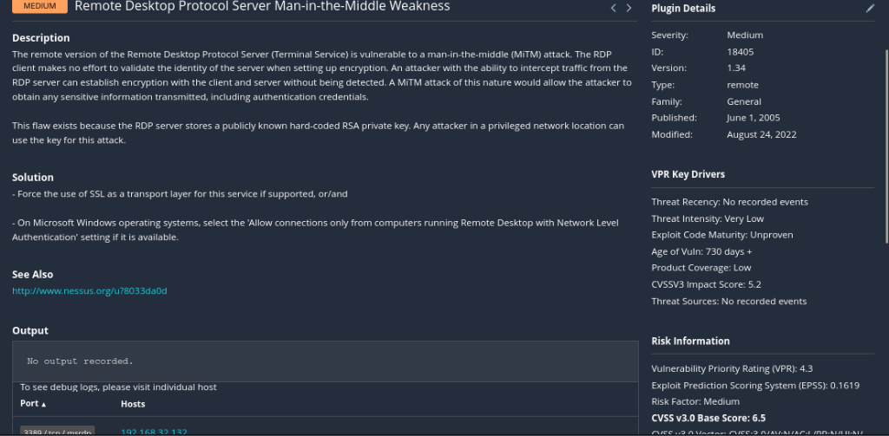

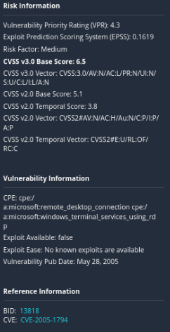

Según la descripción del plugin, un atacante con capacidad para interceptar el tráfico podría aprovechar la debilidad en la autenticación del servidor RDP para acceder a información transmitida. Se registra como **detección del escáner pendiente de validación**: no se ha demostrado interceptación, exposición de credenciales ni explotación. La captura de Output no aporta una respuesta técnica con la que verificar por separado la detección.

El plugin propone forzar SSL como transporte y/o requerir Network Level Authentication (NLA), cuando esté disponible. Como siguiente paso se plantea revisar la configuración real de RDP, documentar el cambio seleccionado y repetir la comprobación. No se afirma que estas medidas estén aplicadas. Este hallazgo no es el mismo que BlueKeep, que aparece en el resumen de remediaciones.

### Remediaciones propuestas por el escáner

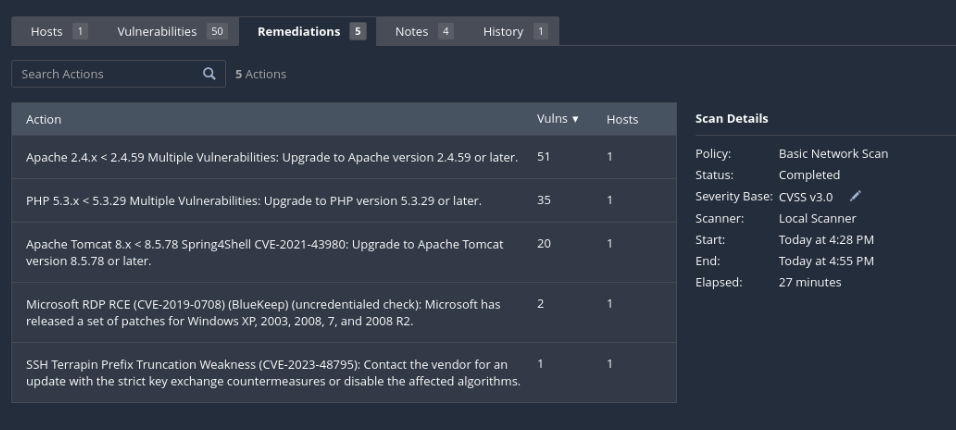

La pestaña muestra cinco acciones asociadas a Apache HTTP Server, PHP, Apache Tomcat, RDP/BlueKeep y SSH/Terrapin. Es una guía inicial de revisión, no evidencia de correcciones realizadas ni confirmación individual de todas las vulnerabilidades agrupadas.

Las versiones de actualización indicadas en la captura son los umbrales propuestos por ese conjunto de plugins. No se presentan como versiones vigentes recomendadas: antes de corregir habría que comprobar el software instalado, su soporte y los avisos del proveedor. Para priorizar se necesita además la salida de cada plugin y la exposición del servicio; los contadores por acción no se suman como CVE únicos.

### Limitaciones y calidad de la evidencia

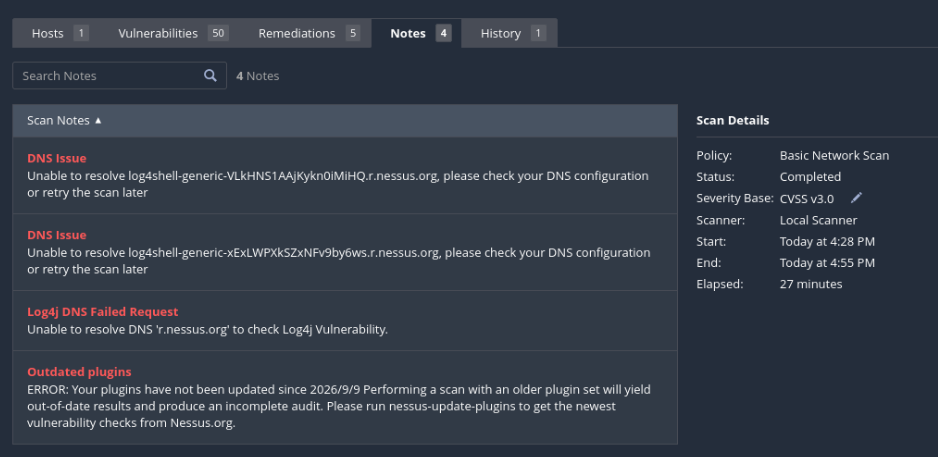

- **Autenticación:** `Auth: Fail` impide presentar este análisis como una auditoría autenticada completa. El resumen no permite determinar si se configuraron credenciales ni la causa del fallo.
- **DNS:** Nessus informa errores al resolver dominios de comprobación bajo `r.nessus.org`, incluida una comprobación Log4j. Estos errores no confirman ni descartan Log4j. No se ha demostrado su causa; la falta de resolución o salida externa debe investigarse antes de repetir esas pruebas.
- **Plugins:** el aviso indica que no se actualizan desde `2026/9/9` y advierte de cobertura incompleta. No se atribuye automáticamente a la licencia ni se afirma que la actualización esté resuelta.
- **Detalle incompleto:** se dispone de un hallazgo RDP individual, pero faltan las salidas de los críticos y altos y la exportación original. No se afirma explotabilidad ni se inventan identificadores para completar las listas.

### Comparación con Nmap

Ambas herramientas se ejecutaron sobre la misma IP del laboratorio, pero las capturas de Nessus aportadas no muestran el detalle de MS17-010 ni del grupo DH débil en 8383/TCP. **El contraste de esas dos detecciones sigue pendiente.** La presencia de resultados RDP o de un contador de críticos no confirma automáticamente los hallazgos SMB/TLS de Nmap.

## Próximos pasos

- Conservar y, cuando se aporten, incorporar los archivos XML/HTML originales para el contraste.
- Incorporar, si está disponible, la exportación original de Nessus y las salidas de plugins críticos y altos.
- Revisar actualización de plugins y resolución DNS; repetir las comprobaciones afectadas y registrar su resultado.
- Contrastar MS17-010 y los parámetros DH con los resultados específicos de Nessus.
- Verificar las condiciones de cada hallazgo antes de afirmar explotabilidad.
- Documentar mitigaciones aplicadas y su comprobación posterior cuando se realicen.

