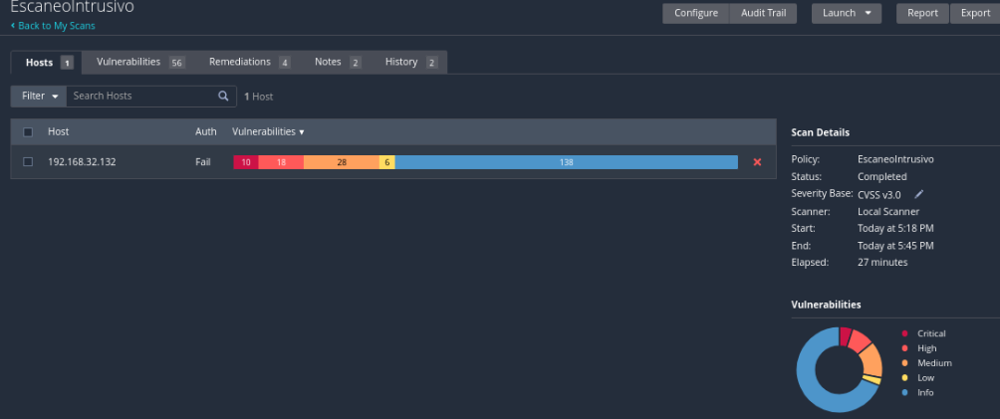
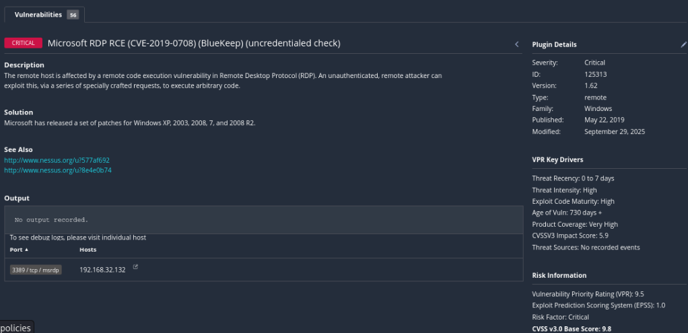
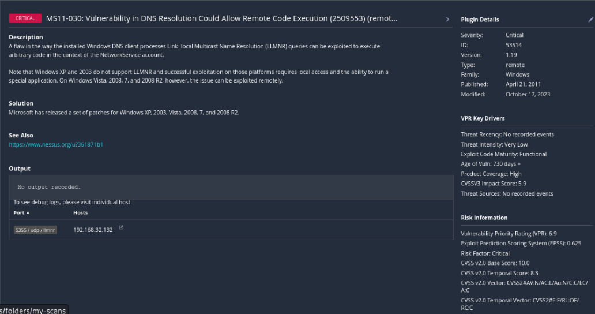
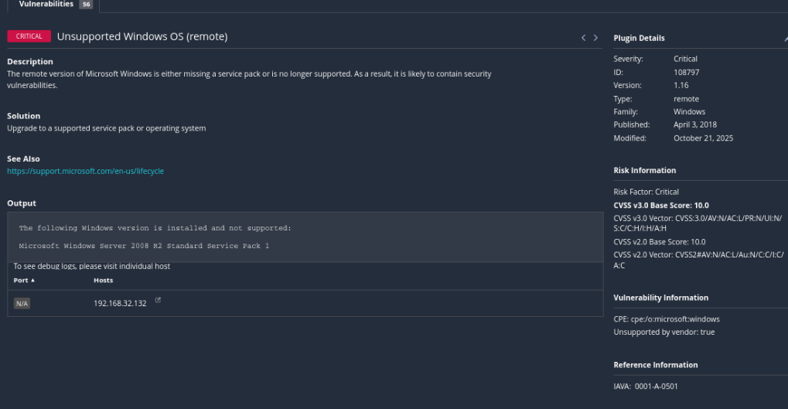
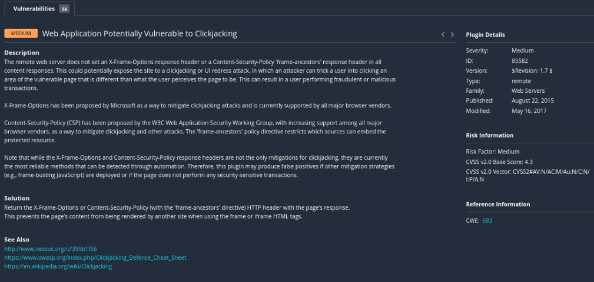
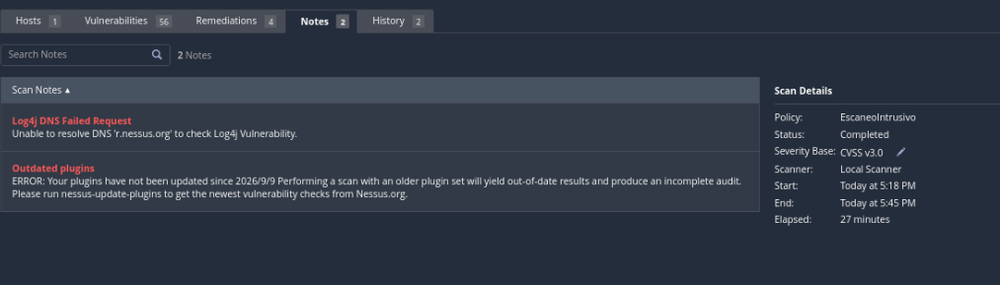

# Evaluación avanzada con Nessus en Windows de laboratorio

**Estado:** práctica guiada y documentación completadas. Los hallazgos son resultados del escáner; la validación manual, las correcciones y las pruebas posteriores permanecen pendientes.

## Objetivo y alcance

Evaluar cómo cambia una evaluación al habilitar pruebas de aplicaciones web y desactivar las comprobaciones seguras de Nessus. El objetivo fue una máquina propia Metasploitable Windows, `192.168.32.132`, accesible desde Kali en una red virtual Sólo host. Es la continuación del [análisis con Nmap y Nessus básico](../01-windows-nmap-nessus/README.md).

## Configuración y ejecución

Se creó una política `Advanced Scan`, llamada `EscaneoIntrusivo`, con estas opciones:

- `Scan web applications`: activado.
- `Enable safe checks`: desactivado. Esto permite comprobaciones que pueden afectar al servicio; no garantiza que se ejecuten todas ni que se detecten todas las vulnerabilidades.
- Objetivo único: `192.168.32.132`.

La configuración se documenta en las [opciones de aplicaciones web](evidencias/config-web.png) y [comprobaciones seguras](evidencias/config-safe-checks.png). Se conservan capturas originales, sin reconstruir resultados.

Hubo intentos anteriores interrumpidos y un problema de conectividad entre las máquinas. Se recuperó la comunicación y se lanzó de nuevo el escaneo. Este caso utiliza el resultado final mostrado como `Completed`: **27 minutos**, de **17:18 a 17:45 según el reloj de la interfaz**. No se mezclan los resultados de las ejecuciones canceladas.

| Severidad | Resultados mostrados en la barra del host |
|---|---:|
| Crítica | 10 |
| Alta | 18 |
| Media | 28 |
| Baja | 6 |
| Informativa | 138 |

La pestaña muestra `Vulnerabilities: 56`. Este contador de la vista no se interpreta como 56 CVE únicos ni se suma a los resultados por severidad. El resumen muestra además `Auth: Fail`, cuatro remediaciones y dos notas. No se aportó el detalle de las cuatro remediaciones de esta ejecución.

## Hallazgos seleccionados y priorización inicial

Las puntuaciones se transcriben con su versión de CVSS: no se comparan como si todas usaran la misma escala. La selección ilustra distintos tipos de problemas y no representa el inventario completo.

| Hallazgo | Plugin | Severidad y puntuación mostradas | Evidencia y límite |
|---|---|---|---|
| Microsoft RDP RCE / BlueKeep, CVE-2019-0708 | 125313 | Crítica, CVSS 3.0: 9,8 | Detección remota sin credenciales en 3389/TCP; `No output recorded` |
| MS11-030: vulnerabilidad en resolución de nombres | 53514 | Crítica, CVSS 2.0: 10,0 | Asociada a LLMNR en 5355/UDP; `No output recorded` |
| Unsupported Windows OS (remote) | 108797 | Crítica, CVSS 3.0: 10,0 | Output identifica Windows Server 2008 R2 Standard Service Pack 1 como no soportado |
| Web Application Potentially Vulnerable to Clickjacking | 85582 | Media, CVSS 2.0: 4,3 | Descripción del control; la captura no incluye la URL afectada ni la respuesta HTTP |

### BlueKeep en RDP

Nessus informa una posible ejecución remota de código en RDP sin autenticación. Es una prioridad de revisión por el impacto descrito, pero la captura no demuestra explotación ni acceso al equipo. La salida vacía limita la comprobación independiente de la detección.

**Acción propuesta:** comprobar versión del sistema y parches aplicables a CVE-2019-0708, restringir RDP a los equipos necesarios y repetir la comprobación después de corregir. No se afirma haber aplicado estas medidas. BlueKeep es distinto del hallazgo de intermediario RDP (plugin 18405) documentado en el análisis básico.

### MS11-030 y LLMNR

El plugin describe un defecto al procesar consultas LLMNR que podría permitir ejecución de código en el contexto de NetworkService. Se registra el boletín MS11-030 y el puerto tal como aparecen; no se agrega un CVE que no figura en la captura.

**Acción propuesta:** verificar la aplicabilidad y presencia de los parches del boletín y revisar si LLMNR es necesario en el entorno. La instalación de parches y una nueva prueba quedan pendientes.

### Sistema operativo fuera de soporte

Este resultado sí incluye una salida que identifica el sistema: Windows Server 2008 R2 Standard Service Pack 1. El hallazgo se refiere al ciclo de soporte; no constituye por sí solo la demostración de una vía de explotación concreta.

**Acción propuesta:** en un entorno productivo, planificar la migración a un sistema soportado. En este laboratorio se conserva el sistema vulnerable para aprender, manteniendo el aislamiento de red.

### Posible clickjacking

El plugin busca ausencia de protección mediante `X-Frame-Options` o `Content-Security-Policy` con `frame-ancestors`. Su propia descripción advierte que pueden existir otras mitigaciones o páginas sin operaciones sensibles, por lo que la ausencia de estos encabezados no demuestra por sí sola un ataque viable.

**Validación pendiente:** identificar la URL exacta, inspeccionar sus respuestas HTTP y comprobar si puede incluirse en un marco y si expone acciones sensibles. La captura no permite asociar el hallazgo a una aplicación o puerto concreto.

**Acción propuesta:** configurar una política de inclusión en marcos acorde con la aplicación y verificar su comportamiento. No se ha realizado una prueba de concepto ni aplicado una corrección.

## Limitaciones de la evaluación

- **Autenticación fallida:** `Auth: Fail`; no se presenta como una auditoría autenticada completa. La captura no explica la causa.
- **Comprobación Log4j incompleta:** no se pudo resolver `r.nessus.org`. Esto no confirma ni descarta Log4j en el objetivo.
- **Plugins desactualizados:** el aviso indica que no se actualizan desde `2026/9/9` y advierte sobre cobertura incompleta. No se ha verificado su actualización posterior.
- **Evidencia disponible:** capturas seleccionadas, sin exportación original `.nessus`, inventario completo ni registro íntegro de ejecución. La interfaz solicitó una actualización de plan para generar el informe HTML; esta documentación es un informe propio, no una exportación nativa de Nessus.
- **Impacto no medido:** desactivar Safe Checks no prueba que una comprobación concreta se haya ejecutado ni que haya causado las incidencias anteriores. No se registró una medición de disponibilidad durante toda la ejecución.

## Comparación con el análisis básico

| Dato visible | Basic Network Scan | Advanced Scan |
|---|---:|---:|
| Duración | 27 minutos | 27 minutos |
| Críticas | 21 | 10 |
| Altas | 28 | 18 |
| Medias | 34 | 28 |
| Bajas | Número no legible | 6 |
| Informativas | 117 | 138 |
| Autenticación | Fail | Fail |

**Menos resultados críticos no demuestra una mejora del sistema ni menor capacidad del escaneo.** No se documentaron correcciones entre ambas ejecuciones y no hay exportaciones completas para comparar plugin por plugin. Las configuraciones y condiciones de ejecución difieren; no se puede atribuir la diferencia a una sola causa.

Tampoco se ha correlacionado aquí MS17-010 ni el grupo Diffie-Hellman débil que reportó Nmap. BlueKeep no sustituye esa validación.

## Cierre de la práctica

Se practicó la configuración de una política avanzada, la lectura de severidades y evidencias, la selección de hallazgos y el registro de limitaciones. La práctica de Nessus queda documentada; esto no equivale a declarar el equipo corregido ni a completar una auditoría exhaustiva.

`Advanced Dynamic Scan` se revisó únicamente como contenido teórico sobre selección de plugins mediante reglas; **no se ejecutó**. La presentación de otras herramientas también fue teórica y no se añade como experiencia práctica.

El portafolio se cierra con el [contraste de MS17-010 mediante Metasploit](../03-contraste-ms17-010/README.md). Se documentó una segunda detección; no se demostró explotación exitosa. Las validaciones y correcciones no realizadas quedan como limitaciones de esta entrega.
