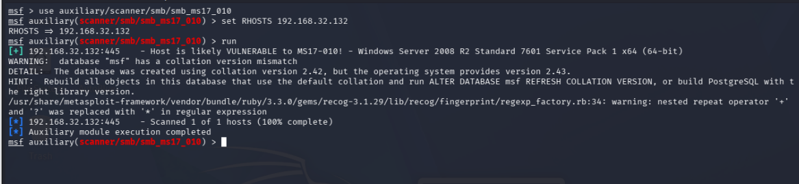

# Contraste de MS17-010 con un escáner auxiliar

**Estado:** detección contrastada con una segunda herramienta; explotación no demostrada. Cierre documental: 13 de octubre de 2026.

## Objetivo y alcance

Contrastar la detección de Nmap sobre la máquina Windows propia del laboratorio, `192.168.32.132`, mediante el módulo auxiliar `auxiliary/scanner/smb/smb_ms17_010` de Metasploit. El [caso previo](../01-windows-nmap-nessus/README.md) conserva la salida de Nmap.

## Evidencia seleccionada

La captura original muestra el módulo seleccionado, el objetivo configurado y la ejecución terminada con `Scanned 1 of 1 hosts (100% complete)` y `Auxiliary module execution completed`.

| Observación | Interpretación |
|---|---|
| `Host is likely VULNERABLE to MS17-010!` en 445/TCP | Detección probable del escáner; coincide con el resultado previo de Nmap |
| Windows Server 2008 R2 Standard 7601 Service Pack 1 x64 | Identificación reportada por la herramienta |
| Aviso de collation en la base de datos y advertencia de expresión regular | Incidencias visibles; no impidieron que esta ejecución mostrara resultado y finalización |

## Resultado

Hay coincidencia entre dos herramientas sobre MS17-010. Esto mejora el respaldo de la detección, pero no equivale a verificar manualmente los parches ni a demostrar explotación. Dos escáneres pueden apoyarse en comprobaciones similares.

Las capturas posteriores muestran un intento de utilizar un módulo de explotación que terminó con `Msf::OptionValidateError` al validar `RHOSTS`. No aportan evidencia de una sesión abierta, acceso remoto o ejecución de comandos. Se omiten del recorrido principal las capturas repetidas de opciones y comandos erróneos, conservando aquí el resultado verificable y el límite del intento.

## Propuesta de remediación y límites

Revisar los parches correspondientes a MS17-010, la necesidad de SMBv1 y la exposición de SMB; tras una eventual corrección, repetir las comprobaciones. Son acciones propuestas: no se aplicaron ni se verificaron en esta entrega.

No se resuelve con esta prueba el contraste pendiente de los parámetros TLS ni las limitaciones de Nessus. Esta práctica cierra el portafolio con una detección contrastada, sin presentar el intento posterior como un compromiso exitoso del equipo.
